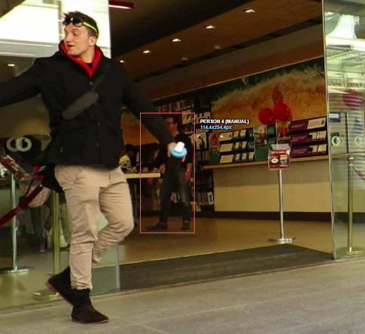
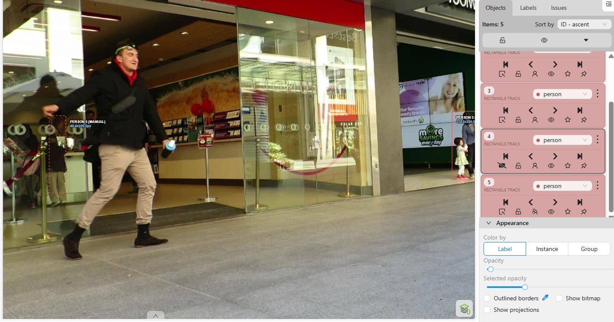
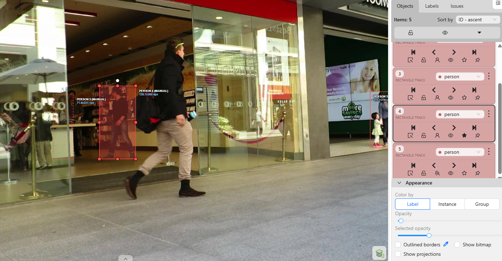

## 0. Thông tin học viên

- Họ tên: Ngô Trí Anh
- MSSV: 2A202604053
- Mã đề (A/B/C): A
- Email: ngotrianh196@gmail.com
- Link repository: https://github.com/AnhNgo1702/K5-L2B-DAY05-NgoTriAnh-2A202604053-MOTTracking.git
- Giờ bắt đầu: 4h 13/11/2026
- Giờ kết thúc: 12h 14/11/2026

## 1. Xem trước đoạn video (CP0)

Ghi **trước khi vẽ**, mỗi người một dòng.

| Mã | Frame xuất hiện | Frame cuối thấy được | Rẽ / dừng / đổi tốc độ ở frame | Bị che ở frame | Ghi chú |
|---|---|---|---|---|---|
| P1 |0|149|Không có|Không có| |
| P2 |0|149|Không có|Không có| |
| P3 |0|108|40|108| |
| P4 |0|149|Không có|40 | |
| P5 |39|149|60|không có| |

## 2. Keyframe và thời gian (CP1, CP4)

Số keyframe lấy từ kết quả `src/check_submission.py`.

| Mã | Số keyframe | Keyframe ở frame | Số frame có mặt | Keyframe / 100 frame | Thời gian (phút) | Chỗ khó |
|---|---|---|---|---|---|---|
| P1 |17|0, 9, 10, 19, 29, 39, 49, 59, 69, 79, 89, 99, 109, 119, 129, 139, 149|150|11.3|10|Không khó|
| P2 |17|0, 9, 10, 19, 29, 39, 49, 59, 69, 79, 89, 99, 109, 119, 129, 139, 149|150|11.3|10|Không khó|
| P3 |12|0, 9, 10, 19, 29, 39, 49, 59, 69, 79, 89, 99|109|11.0|20|Xác định được frame che do có một số fram lộ ra đứa trẻ. Quyết định vẫn đánh outside|
| P4 |16|0, 9, 19, 29, 51, 56, 59, 69, 79, 89, 99, 109, 119, 129, 139, 149|138|11.6|30|Phải xác định frame nào là occluded frame nào outside hoàn toàn và frame nào thì xuất hiện trở lại|
| P5 |14|39, 45, 49, 59, 69, 78, 79, 89, 99, 109, 119, 129, 139, 149|111|12.6|20|Chỉ khó khăn lúc xác định đối tượng xuất hiện ở frame nào |
| **Tổng** |76|658|-|11.6|90|Nhìn chung không có khó khăn nhiều khi đã đọc kĩ walkthrough|

Keyframe / 100 frame của cả bài = tổng keyframe ÷ tổng số frame có mặt × 100 = 11.6

Bạn đặt keyframe nhiều nhất ở người nào? Vì sao (người đó rẽ, dừng, lại gần camera hay bị che)?

Đặt keyframe nhiều nhất cho P4 vì người này có nhiều trạng thái khác như bị che 1 phần hay bị che hoàn toàn

## 3. Đoạn bị che (CP2)

Người bị che: `P4`

| Mốc | Frame |
|---|---:|
| Bắt đầu bị che một phần (bật `occluded`) |30|
| Mất hẳn (bật `outside`) |40|
| Hiện lại (tắt `outside`) |52|
| Thấy rõ trở lại (tắt `occluded`) |57|

- Thời gian khuất hẳn: 12 frame = 0.4 giây.
- Quyết định: giữ cùng ID.
- Lý do (trả lời 3 câu: khuất bao lâu so với 60 frame, ngoại hình có khớp, chỗ hiện lại có đúng hướng và tốc độ):
  - Thời gian khuất: 12 frame (từ frame 40 đến 51), ngắn hơn nhiều so với ngưỡng 60 frame nên chắc chắn giữ cùng ID.
  - Ngoại hình: Quần áo, dáng người và kích thước box khi hiện lại khớp với trước khi bị che.
  - Hướng và tốc độ: Người xuất hiện lại đúng hướng đi dự kiến và tốc độ di chuyển tương tự như trước khi bị che.

Ảnh chụp màn hình:





## 4. Tự review ID (CP3)

Lượt 1 theo người (đi ngược từ frame 149 về 0 trên CVAT), lượt 2 theo cảnh (nhảy 10 frame). Ít nhất 3 dòng; không có lỗi thì ghi một dòng "đã kiểm hai lượt, không lỗi".

Loại lỗi dùng đúng một trong 7 mã: `id_switch`, `fragmentation`, `lost`, `merge`, `false_track`, `drift`, `flag`.

Đã kiểm hai lượt, không phát hiện lỗi ID.

Tổng hợp số lỗi theo loại:

| `id_switch` | `fragmentation` | `lost` | `merge` | `false_track` | `drift` | `flag` |
|---:|---:|---:|---:|---:|---:|---:|
| 0 | 0 | 0 | 0 | 0 | 0 | 0 |

Lỗi nào chỉ lượt 2 (theo cảnh) mới thấy, lượt 1 (theo người) không thấy? Vì sao?

Không có lỗi nào được phát hiện ở cả hai lượt.

## 5. File xuất và kết quả tự kiểm (CP4)

| Kiểm tra | Kết quả |
|---|---|
| Tên file MOT 1.1 | NgoTriAnh_mot.zip |
| Tên file CVAT for video 1.1 | NgoTriAnh_cvat_video.zip |
| Số track ID khác nhau trong `gt/gt.txt` (phải là 5) | 5 |
| Frame `outside` không có dòng trong `gt.txt` (đúng / sai) | Đúng |
| Job đã completed trên CVAT máy cá nhân | Đã completed |

Dán phần tóm tắt in ra từ `src/check_submission.py`:

```text
=== Tóm tắt ===
  Lỗi: 0   |   Cảnh báo: 0
  Đạt.
```

## 6. Ba câu kết

1. Nếu được gán lại, bạn sẽ đặt keyframe khác ở đâu? Vì sao?

   Tôi sẽ đặt thêm keyframe cho P4 ở khoảng frame 40-52 (đoạn bị che hoàn toàn) để theo dõi vị trí ước lượng chính xác hơn khi người đó bị che khuất. Điều này giúp box xuất hiện đúng vị trí hơn khi người đó hiện lại, giảm khả năng box trôi.

2. Có chỗ nào bạn không chắc "cùng ID hay ID mới"? Bạn đã quyết định và ghi chú thế nào?

   Ban đầu không chắc ở P4 khi bị che hoàn toàn từ frame 40-51 (12 frame). Tuy nhiên, do thời gian khuất ngắn hơn rất nhiều so với ngưỡng 60 frame, và khi hiện lại ngoại hình, hướng đi, tốc độ đều khớp, nên quyết định giữ cùng ID. Đã ghi chú trong mục 3 với đầy đủ lý do.

3. Một lỗi ID trong job của bạn (nếu không còn sót, chọn lỗi đã sửa) có thể làm xe tự lái dự đoán sai chuyển động của người đó như thế nào? Lỗi đó ảnh hưởng MOTA hay IDF1 nhiều hơn?

   Giả sử có lỗi `id_switch` ở P4 khi bị che (đổi sang ID mới), xe tự lái sẽ nghĩ người cũ "biến mất" và có người mới "xuất hiện" đột ngột, dẫn đến dự đoán sai quỹ đạo di chuyển. Xe có thể không dự đoán được người đó sẽ đi về hướng nào sau khi hiện lại. Lỗi này ảnh hưởng IDF1 nhiều hơn vì IDF1 đo khả năng giữ ID xuyên suốt, trong khi MOTA chủ yếu đo detection (mỗi lần đổi ID chỉ tăng IDSW thêm 1).

## Bonus (nếu làm)

### B1 — Hai người đi sát

...

### B2 — So cách đặt keyframe

| Cách đặt | Số keyframe | Frame trôi nhất | Ghi chú |
|---|---:|---:|---|
| Đều mỗi 30 frame | | | |
| Theo chỗ đổi hướng | | | |

...

### B3 — So với tracker có sẵn

| Frame | Mã người | Tracker làm gì | Nhãn của bạn | Giải thích (đoán rồi sửa / ghép IoU / box score thấp / ngoại hình) |
|---:|---|---|---|---|
| | | | | |
| | | | | |

## 7. Tài liệu tham khảo và công cụ AI đã dùng

- Tài liệu hướng dẫn: GUIDELINE.md, MOT_FORMAT.md, CVAT_CHEATSHEET.md
- Công cụ: CVAT (Computer Vision Annotation Tool) cho việc gán nhãn và tracking
- Script kiểm tra: check_submission.py để tự kiểm file xuất
- AI Assistant: Kiro để hỗ trợ hoàn thiện báo cáo
